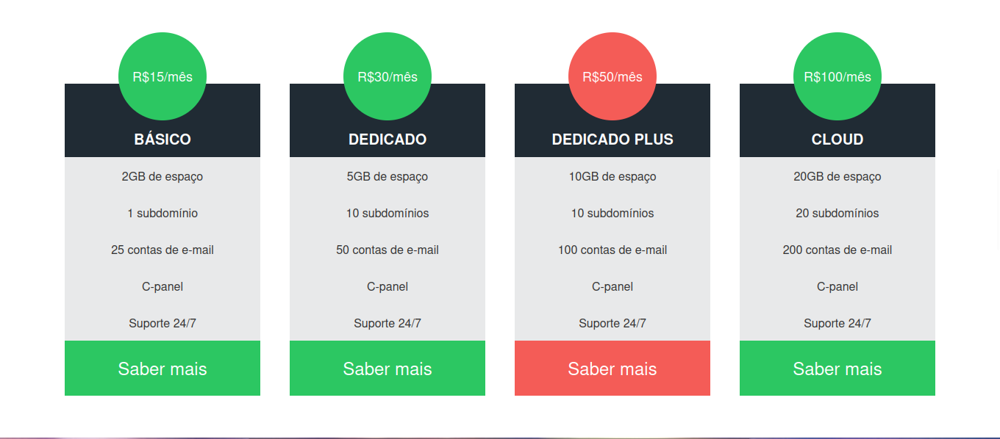

# hDC Host

A responsive landing page for a fictional hosting company, designed to showcase modern web development practices.

## Technologies Used

This project utilizes the following technologies:

- **HTML5**: For semantic structuring of the content.
- **CSS3**: For styling, responsive design (Flexbox/Grid), and visual effects.
- **Font Awesome**: For vector icons (CDN).

## Project Structure

Here is the file structure of the project:

```bash
.
├── assets
│   ├── css
│   │   └── styles.css
│   └── img
│       └── hdchostlogo.png
├── index.html
└── README.md
```

## How to Run

Since this is a static webpage, no build process or server installation is required.

1. Clone the repository:

   ```bash
   git clone https://github.com/alexandrerogeriosn93/project-html-css-hdc-host.git
   ```

2. Navigate to the project folder.
3. Double-click `index.html` to open it in your default web browser.

## Screenshots

### Home & Services


### Pricing & Contact


